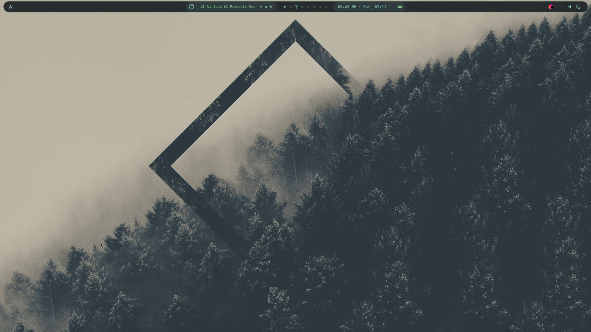
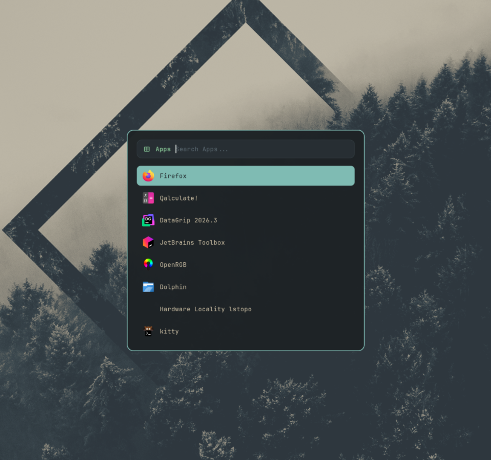
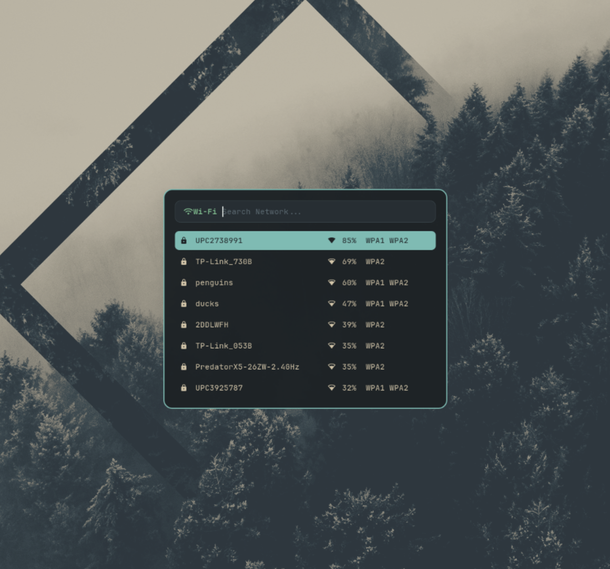
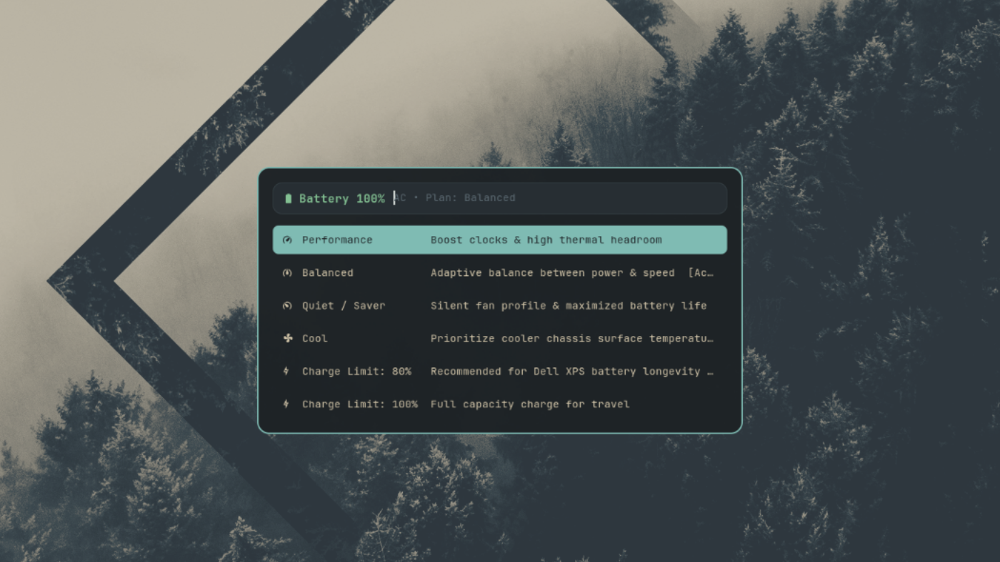
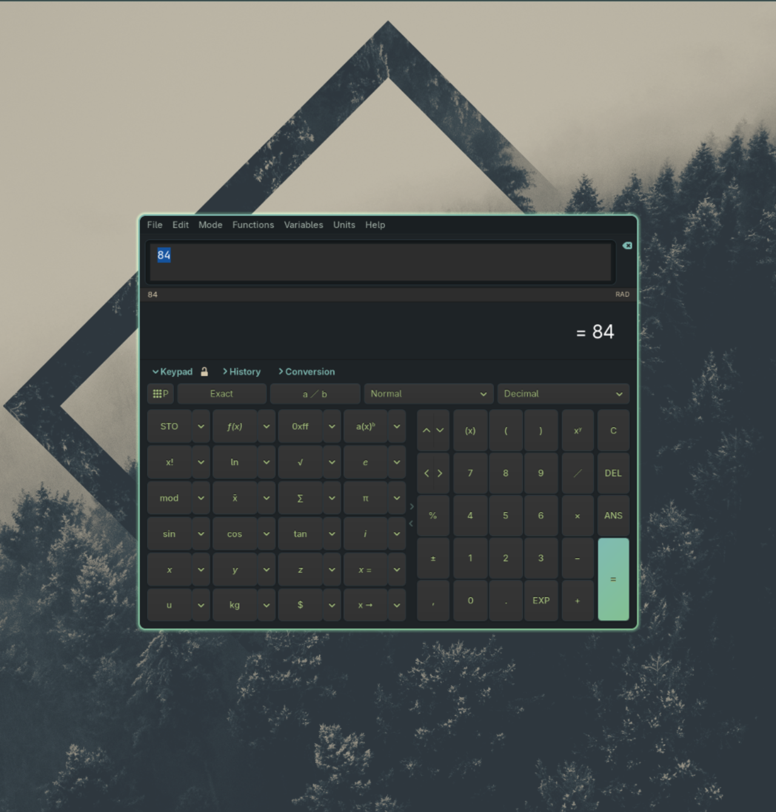

# 🌌 Hyprland Themes & Modular Arch Dotfiles

<p align="center">
  
</p>

<p align="center">
  
  
  
  
  
</p>

A clean, modular desktop configuration designed for Arch Linux and Hyprland. Built with a strict separation between **functional workflows** (keybinds, interactive status menus, utility daemons) and **visual themes** (colors, CSS, wallpapers).

Switch themes in seconds or take just the functional scripts without touching your current colors.

---

## 🎨 Featured Themes

### 🌊 1. Deep Sea & Everforest
A calm, elegant aesthetic inspired by deep oceanic trenches and the Everforest palette. Features deep oceanic obsidian surfaces (`#1E2326`, `#272E33`), soft aquamarine cyan accents (`#7FBBB3`), calm pine/sage greens (`#83C092`), and warm sand highlights (`#D3C6AA`).

<p align="center">
  
  
  
  
  
</p>

| Component | Deep Sea Theme Integration |
|---|---|
| **Hyprland** | Lua-based config (`hyprland.lua`), glowing aquamarine & sage borders, dynamic window opacity toggles |
| **Waybar** | Floating pill styling, interactive system status indicators & OSD popups |
| **Rofi** | Custom rounded menus for Application Launcher, Cheatsheet, Wi-Fi, Calculator, and Power Menu |
| **Lockscreen** | Custom `hyprlock.conf` with minimalist clock, battery stats, and avatar styling |
| **Terminal** | `kitty` color scheme (`deepsea.conf`) + `fastfetch` system banner |
| **GTK & Apps** | Custom GTK-3 CSS styling + `qalculate-gtk` dark everforest scheme with margin bugfix shim |
| **Extras** | Matching JetBrains IDE theme plugin (`Deep Sea`) & Limine bootloader theme |

### 🌌 2. Obsidian Pink
A high-contrast cyberpunk aesthetic featuring deep obsidian glass surfaces (`#0b0813`), accented with neon hot pink (`#ff3b81`) and violet glowing borders (`#a855f7`).

<p align="center">
  
  
  
  
</p>

---

## 📸 Screenshots (Deep Sea & Everforest)

All screenshots captured with the clean desktop wallpaper background:

<p align="center">
  
  
</p>

<p align="center">
  
  
</p>

<p align="center">
  
</p>

---

## ⚡ Quick Start

### 1. Clone the repository
```bash
git clone https://github.com/d0kt0rEu/hyprland-themes.git
cd hyprland-themes
```

### 2. Run the Installer
```bash
./install.sh
```

The interactive installer allows you to choose your theme:
```text
Select installation mode:
  [1] Full Installation (Select theme + common scripts & keybindings)
  [2] Scripts & Keybinds Only (Preserves your existing theme, CSS & wallpapers)
  [3] Theme Only (Choose from available themes)
  [4] Extras Only (JetBrains themes, Limine configs)
  [5] Exit
```

Or run non-interactively via flags:
```bash
# Full install of the Deep Sea theme & all scripts
./install.sh --all deep-sea

# Full install of Obsidian Pink theme
./install.sh --all obsidian-pink

# Only install functional scripts and keybindings (leaves your current theme intact)
./install.sh --scripts-only

# Install or switch to a specific theme
./install.sh --theme deep-sea

# Install only JetBrains IDE plugin & bootloader extras
./install.sh --extras
```

> **Note:** Automatic backups of your existing `.config` directories (`hypr`, `waybar`, `rofi`, etc.) are saved to `~/.config/hyprland-dotfiles-backup-<timestamp>` before any changes are written.

---

## ⌨️ Keybindings Reference

All keybindings are accessible anytime on your desktop by pressing <kbd>Super</kbd> + <kbd>K</kbd>.

### 🚀 Applications & Launchers
| Shortcut | Action |
|---|---|
| <kbd>Super</kbd> + <kbd>Q</kbd> | Open Kitty terminal |
| <kbd>Super</kbd> + <kbd>E</kbd> | Open Dolphin file manager |
| <kbd>Super</kbd> + <kbd>R</kbd> | Application launcher (Rofi) |
| <kbd>Super</kbd> + <kbd>K</kbd> | Interactive Keybinding Cheatsheet |
| <kbd>Super</kbd> + <kbd>=</kbd> or <kbd>Calc</kbd> | Quick Calculator (Rofi / Qalculate) |
| <kbd>Super</kbd> + <kbd>M</kbd> | System Power / Logout Menu |
| <kbd>Click Battery Widget</kbd> | Power Plans & Battery Options (Performance / Balanced / Quiet) |
| <kbd>Super</kbd> + <kbd>B</kbd> | Toggle Waybar top bar visibility (instant hide/show) |
| <kbd>Super</kbd> + <kbd>Space</kbd> | Switch Keyboard Layout (with Waybar pill OSD) |

### 🪟 Window Management & Transparency
| Shortcut | Action |
|---|---|
| <kbd>Super</kbd> + <kbd>C</kbd> | Close focused window |
| <kbd>Super</kbd> + <kbd>T</kbd> | Toggle floating (single window) |
| <kbd>Super</kbd> + <kbd>V</kbd> | Toggle floating for all windows on active workspace |
| <kbd>Super</kbd> + <kbd>F</kbd> | Toggle maximized fullscreen |
| <kbd>Super</kbd> + <kbd>P</kbd> | Toggle pseudo-tiling mode |
| <kbd>Super</kbd> + <kbd>J</kbd> | Toggle dwindle split orientation |
| <kbd>Super</kbd> + <kbd>←</kbd> <kbd>→</kbd> <kbd>↑</kbd> <kbd>↓</kbd> | Move window focus |
| <kbd>Super</kbd> + <kbd>Shift</kbd> + <kbd>←</kbd> <kbd>→</kbd> <kbd>↑</kbd> <kbd>↓</kbd> | Resize window width/height (+/-30px, hold to repeat) |
| <kbd>Super</kbd> + <kbd>Left Mouse Drag</kbd> | Move floating window |
| <kbd>Super</kbd> + <kbd>Right Mouse Drag</kbd> | Resize floating window |
| <kbd>Ctrl</kbd> + <kbd>Alt</kbd> + <kbd>↑</kbd> | Increase active window opacity (+5%, more solid) |
| <kbd>Ctrl</kbd> + <kbd>Alt</kbd> + <kbd>↓</kbd> | Decrease active window opacity (-5%, more glass) |
| <kbd>Ctrl</kbd> + <kbd>Alt</kbd> + <kbd>Enter</kbd> | Reset active window opacity to 100% |
| <kbd>Ctrl</kbd> + <kbd>Alt</kbd> + <kbd>\</kbd> | Reset all windows opacity to 100% |

### 🧭 Workspaces & Navigation
| Shortcut | Action |
|---|---|
| <kbd>Super</kbd> + <kbd>1</kbd> .. <kbd>9</kbd>, <kbd>0</kbd> | Switch to workspace 1–10 |
| <kbd>Super</kbd> + <kbd>Shift</kbd> + <kbd>1</kbd> .. <kbd>9</kbd>, <kbd>0</kbd> | Move focused window to workspace 1–10 |
| <kbd>Super</kbd> + <kbd>S</kbd> | Toggle special scratchpad workspace (`magic`) |
| <kbd>Super</kbd> + <kbd>Shift</kbd> + <kbd>S</kbd> | Send active window to special scratchpad |
| <kbd>Super</kbd> + <kbd>Scroll Down</kbd> | Switch to next active workspace (`e+1`) |
| <kbd>Super</kbd> + <kbd>Scroll Up</kbd> | Switch to previous active workspace (`e-1`) |

### 📸 Screenshots
| Shortcut | Action |
|---|---|
| <kbd>Print</kbd> | Select area and copy screenshot directly to clipboard (`grim + slurp`) |
| <kbd>Shift</kbd> + <kbd>Print</kbd> | Select area and open screenshot in Swappy editor |

### 🔉 Hardware & Media Controls
| Shortcut | Action |
|---|---|
| <kbd>XF86AudioRaiseVolume</kbd> | Volume Up (+5% with Waybar pill OSD) |
| <kbd>XF86AudioLowerVolume</kbd> | Volume Down (-5% with Waybar pill OSD) |
| <kbd>XF86AudioMute</kbd> | Toggle Audio Mute (with Waybar pill OSD) |
| <kbd>XF86AudioMicMute</kbd> | Toggle Microphone Mute (with Waybar pill OSD) |
| <kbd>XF86MonBrightnessUp</kbd> | Brightness Up (+5% with Waybar pill OSD) |
| <kbd>XF86MonBrightnessDown</kbd> | Brightness Down (-5% with Waybar pill OSD) |
| <kbd>XF86AudioPlay</kbd> / <kbd>Pause</kbd> | Media Play/Pause toggle (`playerctl play-pause`) |
| <kbd>XF86AudioNext</kbd> | Next track (`playerctl next`) |
| <kbd>XF86AudioPrev</kbd> | Previous track (`playerctl previous`) |

---

## 🗂️ Repository Structure

```text
hyprland-themes/
├── assets/
│   └── screenshots/               # Visual previews for documentation
│       ├── deep-sea/              # Deep Sea Everforest screenshots
│       └── obsidian-pink/         # Obsidian Pink Cyberpunk screenshots
├── common/
│   ├── keybinds/                  # Standalone keybind exports (conf, lua, json, md)
│   ├── scripts/
│   │   ├── waybar/                # OSD pill popups and system status scripts
│   │   └── rofi/                  # Functional launcher, cheatsheet, wifi, power, & calc scripts
│   └── install-scripts.sh         # Installs only functional scripts without touching themes
├── extras/
│   ├── jetbrains-theme/           # JetBrains IDE plugins for CLion, RustRover, IDEA, etc.
│   │   ├── Deep Sea.icls
│   │   ├── deepsea-theme.jar
│   │   ├── Obsidian_Pink.icls
│   │   └── ObsidianPinkTheme.jar
│   ├── limine-theme/              # Bootloader themes & wallpapers for Limine
│   │   ├── deepsea-limine.conf
│   │   └── obsidian-limine.conf
│   └── setup-hyprlock-login.sh    # Instant Hyprlock lockscreen on autologin
├── themes/
│   ├── deep-sea/                  # Deep Sea & Everforest Theme
│   │   ├── config/                # Modular configs (hypr, waybar, rofi, kitty, qalculate...)
│   │   ├── wallpapers/            # High-resolution Everforest & Oceanic wallpapers
│   │   ├── theme.json             # Theme metadata & color palette definition
│   │   └── install.sh             # Independent installer for Deep Sea
│   └── obsidian-pink/             # Obsidian Pink Cyberpunk Theme
│       ├── config/
│       ├── wallpapers/
│       ├── theme.json
│       └── install.sh
├── install.sh                     # Master interactive installation script
├── restore.sh                     # Quick restore script for recovery or syncing
├── LICENSE                        # MIT License
└── README.md
```

---

## 🎨 How to Add a New Theme

The repository is built to support an arbitrary number of themes. To add your own:

1. Create a new directory under `themes/`:
   ```bash
   mkdir -p themes/my-cool-theme/config
   mkdir -p themes/my-cool-theme/wallpapers
   ```
2. Place your theme-specific configuration overrides inside `themes/my-cool-theme/config/`:
   - `hypr/` (`hyprland.lua`, `hyprlock.conf`, `hyprpaper.conf`)
   - `waybar/` (`style.css`, `config.jsonc`, pill css files)
   - `rofi/` (`colors/`, `style-1.rasi`)
   - `kitty/` (`theme.conf`, `kitty.conf`)
3. Add a `theme.json` describing your theme and an `install.sh` script (you can copy `themes/deep-sea/install.sh` as a template).
4. Run `./install.sh` — your new theme will automatically appear in the interactive menu!

---

## 📦 Dependencies

Install the core dependencies on Arch Linux via `pacman`:

```bash
# Core window manager & desktop bar
sudo pacman -S hyprland waybar rofi-wayland kitty dolphin fastfetch

# Wayland utilities & screen management
sudo pacman -S hyprlock hyprpaper grim slurp wl-clipboard brightnessctl playerctl

# Audio & networking
sudo pacman -S wireplumber pipewire-pulse networkmanager

# Calculator & scripting dependencies
sudo pacman -S libqalculate qalculate-gtk python-gobject gtk3
```

---

## 📜 License

This project is licensed under the [MIT License](LICENSE). Feel free to customize, fork, and share!
