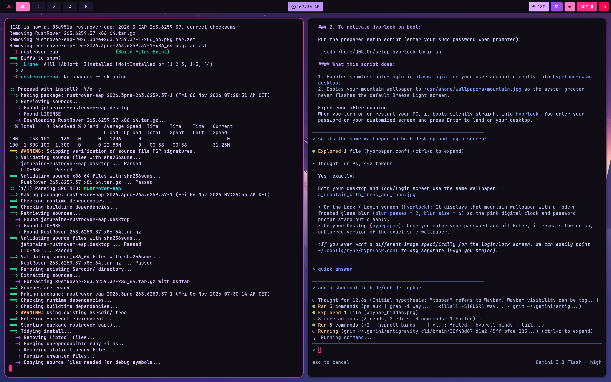
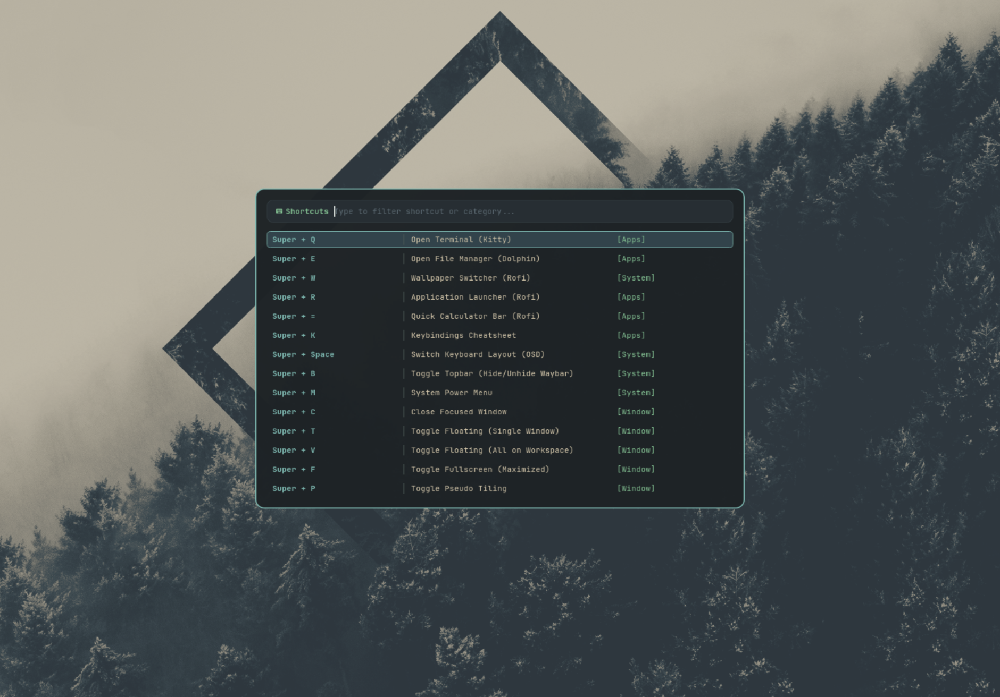
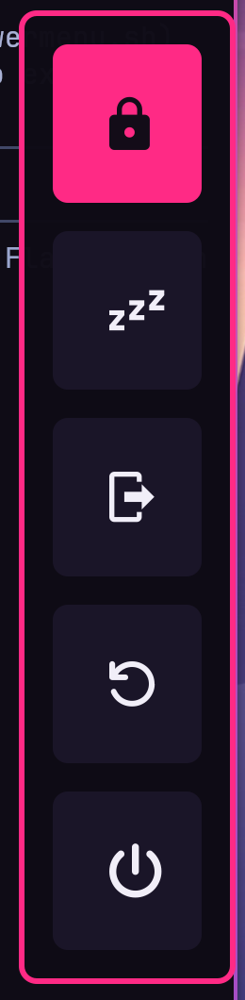
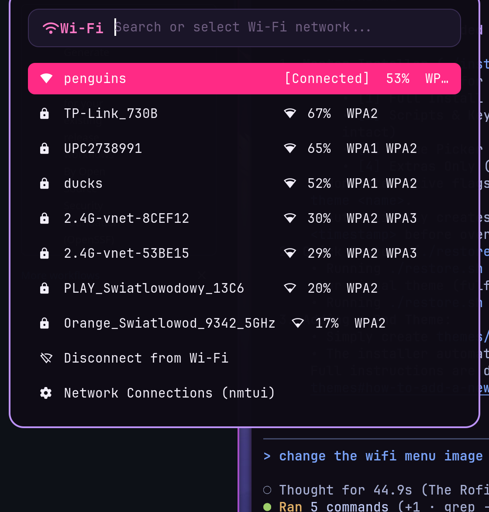
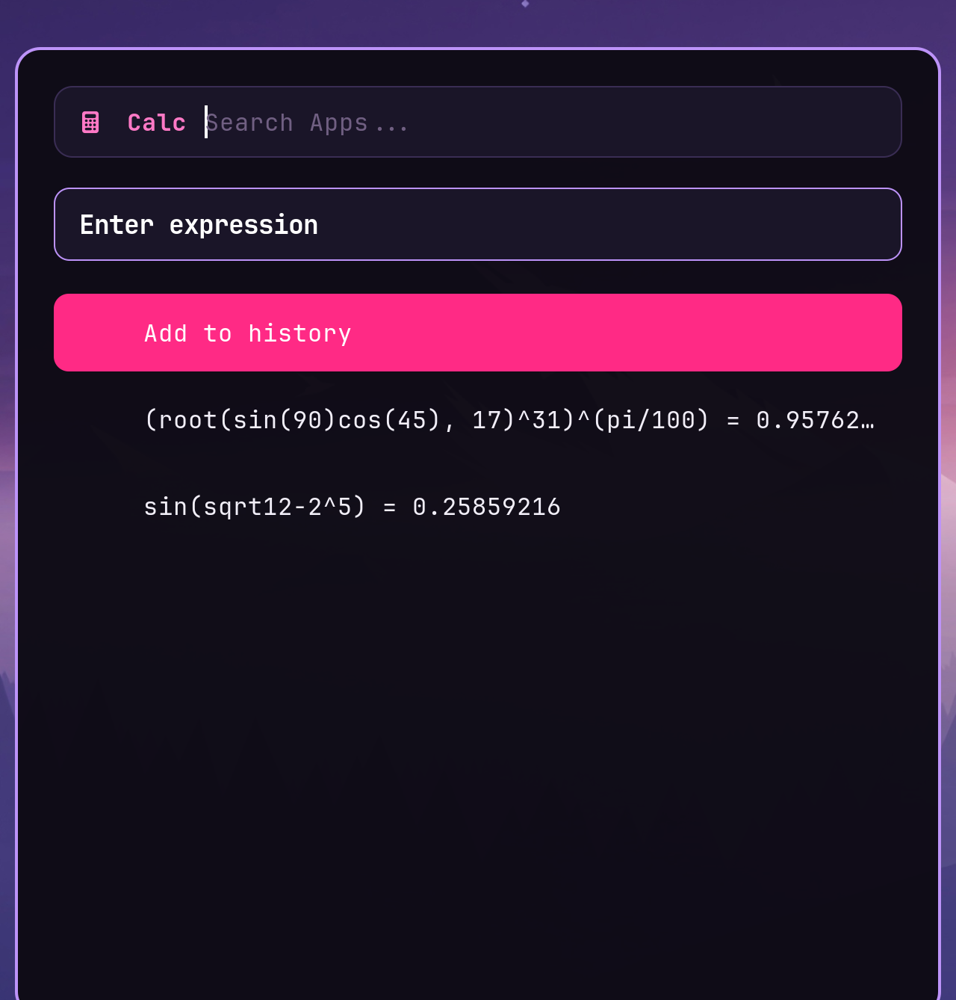
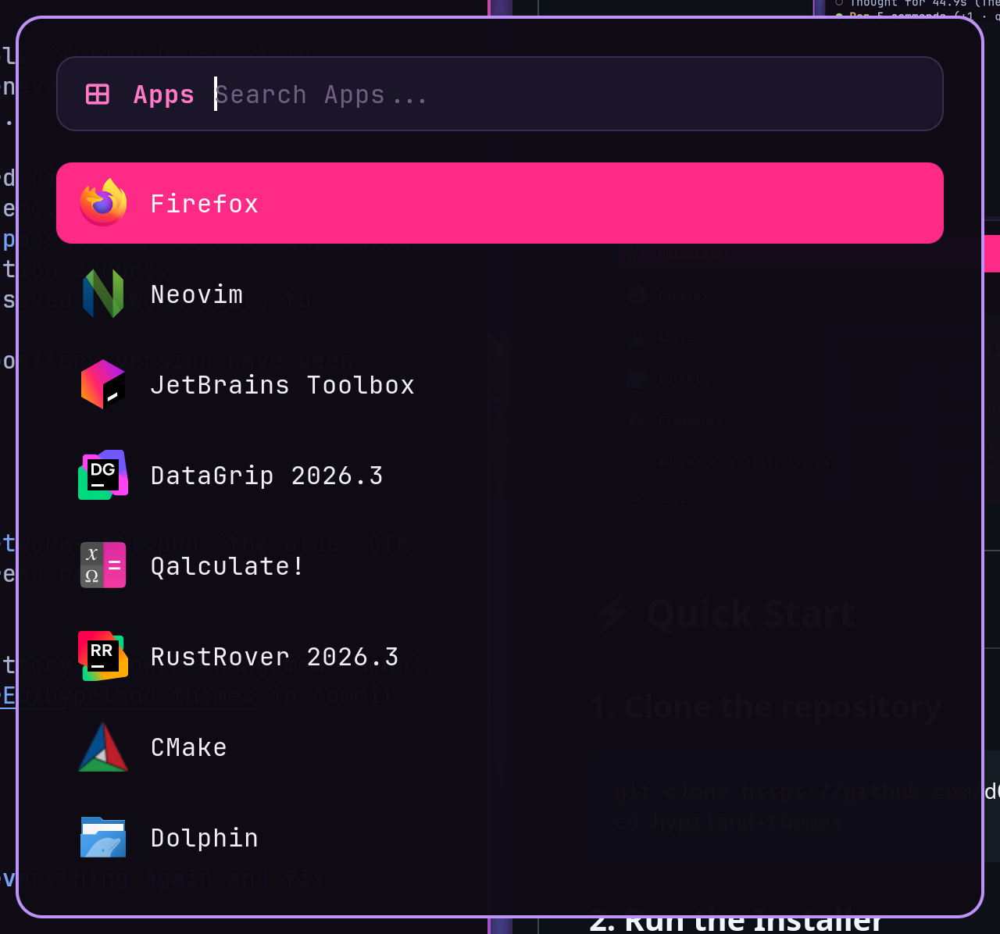
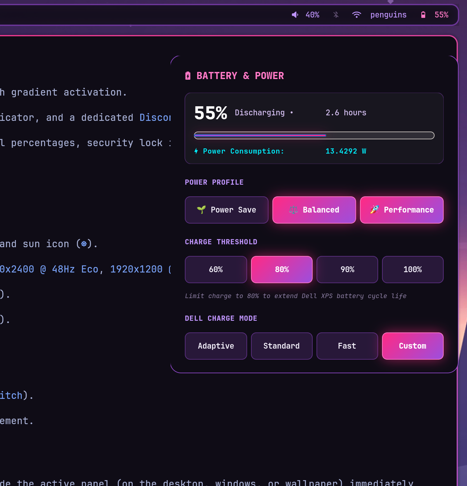

# 🌌 Hyprland Themes & Modular Arch Dotfiles

<p align="center">
  
</p>

<p align="center">
  
  
  
  
  
</p>

A clean, modular desktop configuration designed for Arch Linux and Hyprland. Built with a strict separation between **functional workflows** (keybinds, interactive status menus, utility daemons) and **visual themes** (colors, CSS, wallpapers).

Switch themes in seconds or take just the functional scripts without touching your current colors.

---

## 🎨 Featured Theme: Obsidian Pink

A high-contrast cyberpunk aesthetic featuring deep obsidian glass surfaces (`#0b0813`), accented with neon hot pink (`#ff3b81`) and violet glowing borders (`#a855f7`).

| Component | Theme Integration |
|---|---|
| **Hyprland** | Lua-based config (`hyprland.lua`), active neon borders, dynamic window opacity toggles |
| **Waybar** | Floating pill styling, interactive PyGObject quick menus, OSD indicators |
| **Rofi** | Custom rounded menus for Application Launcher, Cheatsheet, Wi-Fi, Calculator, and Power Menu |
| **Lockscreen** | Custom `hyprlock.conf` with cyberpunk clock, battery stats, and avatar styling |
| **Terminal** | `kitty` color scheme (`cyberpunk-neon.conf`) + `fastfetch` system banner |
| **GTK & Apps** | Dark GTK-3 CSS styling + `qalculate-gtk` dark neon scheme |
| **Extras** | Matching JetBrains IDE theme plugin (`Obsidian Pink`) & Limine bootloader theme |

---

## 📸 Screenshots

<p align="center">
  
  
</p>

<p align="center">
  
  
</p>

<p align="center">
  
  
</p>

---

## ⚡ Quick Start

### 1. Clone the repository
```bash
git clone https://github.com/d0kt0rEu/hyprland-themes.git
cd hyprland-themes
```

### 2. Run the Installer
```bash
./install.sh
```

The interactive installer will ask you how you'd like to install:
```text
Select installation mode:
  [1] Full Installation (Obsidian Pink theme + common scripts & keybindings)
  [2] Scripts & Keybinds Only (Preserves your existing theme, CSS & wallpapers)
  [3] Theme Only (Choose from available themes)
  [4] Extras Only (JetBrains theme, Limine config)
  [5] Exit
```

Or run non-interactively via flags:
```bash
# Full install of the Obsidian Pink theme & all scripts
./install.sh --all

# Only install functional scripts and keybindings (leaves your current theme intact)
./install.sh --scripts-only

# Install or switch to a specific theme
./install.sh --theme obsidian-pink

# Install only JetBrains IDE plugin & bootloader extras
./install.sh --extras
```

> **Note:** Automatic backups of your existing `.config` directories (`hypr`, `waybar`, `rofi`, etc.) are saved to `~/.config/hyprland-dotfiles-backup-<timestamp>` before any changes are written.

---

## ⌨️ Keybindings Reference

All keybindings are accessible anytime on your desktop by pressing <kbd>Super</kbd> + <kbd>K</kbd>.

### 🚀 Applications & Launchers
| Shortcut | Action |
|---|---|
| <kbd>Super</kbd> + <kbd>Q</kbd> | Open Kitty terminal |
| <kbd>Super</kbd> + <kbd>E</kbd> | Open Dolphin file manager |
| <kbd>Super</kbd> + <kbd>R</kbd> | Application launcher (Rofi) |
| <kbd>Super</kbd> + <kbd>K</kbd> | Interactive Keybinding Cheatsheet |
| <kbd>Super</kbd> + <kbd>=</kbd> or <kbd>Calc</kbd> | Quick Calculator (Rofi / Qalculate) |
| <kbd>Super</kbd> + <kbd>M</kbd> | System Power / Logout Menu |
| <kbd>Super</kbd> + <kbd>B</kbd> | Toggle Waybar top bar visibility (instant hide/show) |
| <kbd>Super</kbd> + <kbd>Space</kbd> | Switch Keyboard Layout (with Waybar pill OSD) |

### 🪟 Window Management
| Shortcut | Action |
|---|---|
| <kbd>Super</kbd> + <kbd>C</kbd> | Close active window |
| <kbd>Super</kbd> + <kbd>T</kbd> | Toggle window floating state |
| <kbd>Super</kbd> + <kbd>F</kbd> | Toggle fullscreen mode |
| <kbd>Super</kbd> + <kbd>P</kbd> | Toggle pseudo-tiling mode |
| <kbd>Super</kbd> + <kbd>J</kbd> | Toggle dwindle split orientation |
| <kbd>Super</kbd> + <kbd>←</kbd> <kbd>→</kbd> <kbd>↑</kbd> <kbd>↓</kbd> | Move window focus |
| <kbd>Super</kbd> + <kbd>Shift</kbd> + <kbd>←</kbd> <kbd>→</kbd> <kbd>↑</kbd> <kbd>↓</kbd> | Move window position |
| <kbd>Super</kbd> + <kbd>Ctrl</kbd> + <kbd>←</kbd> <kbd>→</kbd> <kbd>↑</kbd> <kbd>↓</kbd> | Resize window |
| <kbd>Super</kbd> + <kbd>[</kbd> | Set active window opacity to 80% |
| <kbd>Super</kbd> + <kbd>]</kbd> | Set active window opacity to 100% |
| <kbd>Ctrl</kbd> + <kbd>Alt</kbd> + <kbd>\</kbd> | Reset all window transparencies to 100% |

### 🧭 Workspaces
| Shortcut | Action |
|---|---|
| <kbd>Super</kbd> + <kbd>1</kbd> .. <kbd>0</kbd> | Switch to workspace 1–10 |
| <kbd>Super</kbd> + <kbd>Shift</kbd> + <kbd>1</kbd> .. <kbd>0</kbd> | Move focused window to workspace 1–10 |
| <kbd>Super</kbd> + <kbd>S</kbd> | Toggle special scratchpad workspace |
| <kbd>Super</kbd> + <kbd>Shift</kbd> + <kbd>S</kbd> | Send active window to special scratchpad |
| <kbd>Super</kbd> + <kbd>Scroll Up/Down</kbd> | Cycle through active workspaces |
| <kbd>Super</kbd> + <kbd>Left Mouse Drag</kbd> | Move floating window |
| <kbd>Super</kbd> + <kbd>Right Mouse Drag</kbd> | Resize floating window |

### 🔉 Hardware Controls
| Shortcut | Action |
|---|---|
| <kbd>XF86AudioRaiseVolume</kbd> | Volume Up (with Waybar pill OSD) |
| <kbd>XF86AudioLowerVolume</kbd> | Volume Down (with Waybar pill OSD) |
| <kbd>XF86AudioMute</kbd> | Mute Output |
| <kbd>XF86AudioMicMute</kbd> | Mute Microphone |
| <kbd>XF86MonBrightnessUp</kbd> | Brightness Up (with Waybar pill OSD) |
| <kbd>XF86MonBrightnessDown</kbd> | Brightness Down (with Waybar pill OSD) |
| <kbd>Media Play/Pause/Next/Prev</kbd> | Media playback control via `playerctl` |

---

## 🗂️ Repository Structure

```text
hyprland-themes/
├── assets/
│   └── screenshots/               # Visual previews for README & documentation
├── common/
│   ├── keybinds/                  # Standalone keybind exports (conf, lua, json, md)
│   ├── scripts/
│   │   ├── waybar/                # OSD pill popups and system status scripts
│   │   ├── waybar_menus/          # Interactive PyGObject GTK popup menus
│   │   └── rofi/                  # Functional launcher, cheatsheet, wifi, & calc scripts
│   └── install-scripts.sh         # Installs only functional scripts without touching themes
├── extras/
│   ├── jetbrains-theme/           # Obsidian Pink theme plugin for CLion, RustRover, IDEA
│   ├── limine-theme/              # Obsidian Pink styling for Limine bootloader
│   └── setup-hyprlock-login.sh    # Instant Hyprlock lockscreen on autologin
├── themes/
│   └── obsidian-pink/             # The Obsidian Pink theme package
│       ├── config/                # Modular config directory overrides
│       │   ├── fastfetch/
│       │   ├── fuzzel/
│       │   ├── gtk-3.0/
│       │   ├── hypr/
│       │   ├── kitty/
│       │   ├── qalculate/
│       │   ├── rofi/
│       │   └── waybar/
│       ├── wallpapers/            # High-res wallpapers for this theme
│       ├── theme.json             # Theme metadata & color palette definition
│       └── install.sh             # Independent installer for this theme
├── install.sh                     # Master interactive installation script
├── restore.sh                     # Quick restore script for recovery or syncing
├── LICENSE                        # MIT License
└── README.md
```

---

## 🎨 How to Add a New Theme

The repository is built to support an arbitrary number of themes. To add your own:

1. Create a new directory under `themes/`:
   ```bash
   mkdir -p themes/my-cool-theme/config
   mkdir -p themes/my-cool-theme/wallpapers
   ```
2. Place your theme-specific configuration overrides inside `themes/my-cool-theme/config/`:
   - `hypr/` (`hyprland.lua`, `hyprlock.conf`, `hyprpaper.conf`)
   - `waybar/` (`style.css`, `config.jsonc`, pill css files)
   - `rofi/` (`colors/`, `style-1.rasi`)
   - `kitty/` (`theme.conf`, `kitty.conf`)
3. Add a `theme.json` describing your theme and an `install.sh` script (you can copy `themes/obsidian-pink/install.sh` as a template).
4. Run `./install.sh` — your new theme will automatically appear in the interactive menu!

---

## 📦 Dependencies

Install the core dependencies on Arch Linux via `pacman` and `yay`:

```bash
# Core window manager & desktop bar
sudo pacman -S hyprland waybar rofi-wayland kitty dolphin fastfetch

# Wayland utilities & screen management
sudo pacman -S hyprlock hyprpaper grim slurp wl-clipboard brightnessctl playerctl

# Audio & networking
sudo pacman -S wireplumber pipewire-pulse networkmanager

# Calculator & scripting dependencies
sudo pacman -S libqalculate qalculate-gtk python-gobject gtk3
```

---

## 📜 License

This project is licensed under the [MIT License](LICENSE). Feel free to customize, fork, and share!
